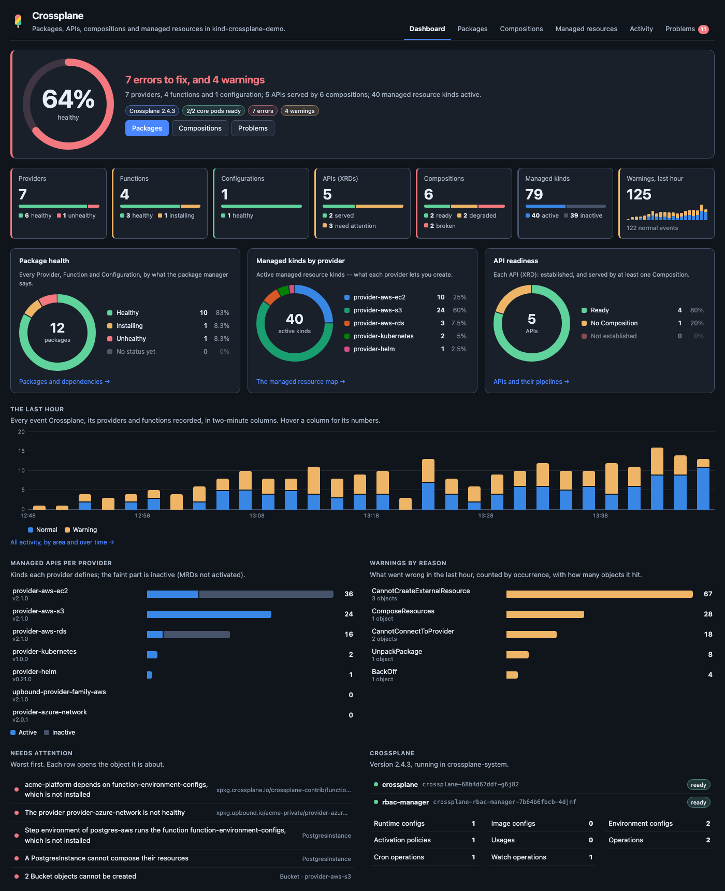
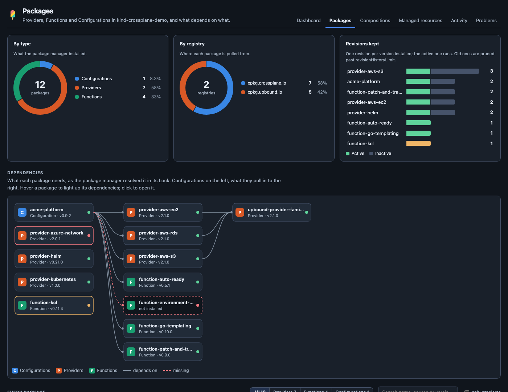
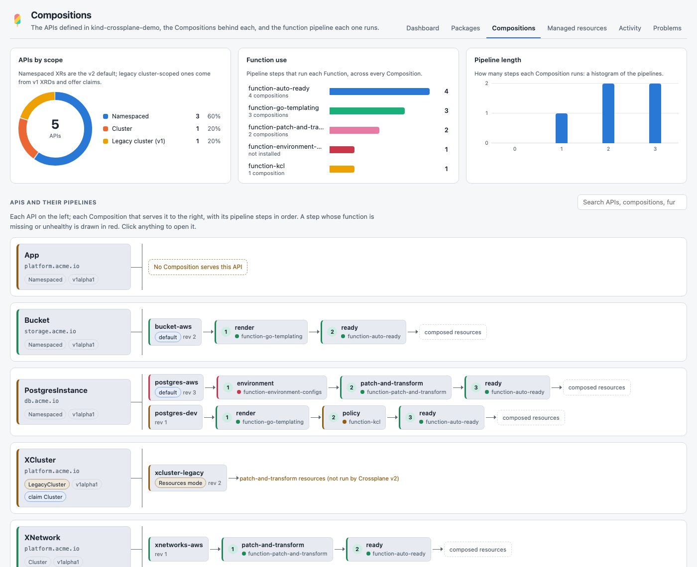
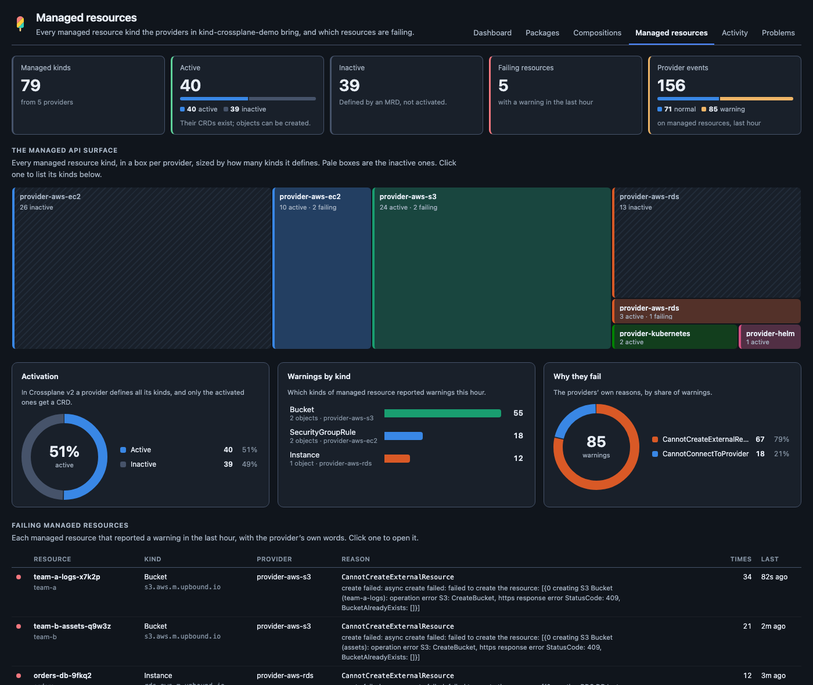
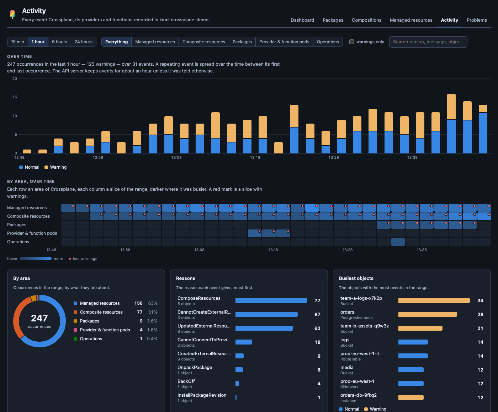

# Crossplane for K8s Dockside

A [K8s Dockside](https://github.com/k8sdockside/k8sdockside) plugin for
[Crossplane](https://www.crossplane.io/), the cloud native control plane:
its packages, the APIs a platform team defines with it, the Compositions and
function pipelines behind them, and the managed resources its providers
reconcile -- drawn, rather than listed.

Crossplane has no screen of its own. Everything it knows is spread over a
dozen kinds -- Providers, Functions, Configurations and their revisions, the
Lock, XRDs, Compositions, MRDs -- plus hundreds of managed resource kinds that
every provider brings. This plugin joins them up.

<!-- markdownlint-disable-next-line MD033 -->




## What it shows

**Dashboard** -- a verdict in one sentence beside a control-plane health
gauge, then seven tiles: providers, functions, configurations, APIs,
compositions, managed resource kinds and the last hour's warnings, each split
by state. Three rings: package health, active managed kinds by provider, and
API readiness. A histogram of every Crossplane event in the last hour, normal
and warning. Managed APIs per provider and warnings by reason as bar charts.
What needs attention, worst first. And Crossplane itself: its own pods and
version, runtime and environment configs, activation policies, usages and
operations.

**Packages** -- packages by type and by registry, the revisions each keeps,
and the **dependency graph** the package manager resolved in its Lock:
Configurations on the left, what they pull in to the right, a dashed red
ghost for a dependency nothing satisfies. Hovering a package lights up what it
needs and what needs it. Under it, a card per package: state, source,
version, activation policy, runtime config, its pods (ready, restarts,
`CrashLoopBackOff`), how many managed kinds it brings, who needs it, and its
revisions as a timeline with the active one filled.



**Compositions** -- each API (XRD) on the left, each Composition serving it
to the right, and each Composition's **function pipeline** step by step, every
step coloured by the health of the Function it runs. A step on a Function that
is not installed is red; a Composition still in the legacy `Resources` mode,
an API with no Composition, and a Composition for an API nobody defined are
all called out. With APIs by scope (namespaced, cluster, legacy cluster),
function use across pipelines, and a histogram of pipeline lengths.



**Managed resources** -- a **treemap** of every provider's managed API
surface, active kinds solid and inactive (MRDs not activated) hatched;
activation as a ring; warnings by kind and by reason; a table of every managed
resource that reported a warning this hour with the provider's own words; and
every kind, searchable, each active one opening as a table of its objects in
the app.



**Activity** -- every event about a Crossplane object over 15 minutes, an
hour, 6 or 24 hours: a stacked histogram, a **heatmap** of areas (managed
resources, composites, APIs, packages, runtime pods, operations) against time,
events by area, reasons, the busiest objects, and the events themselves,
filterable by area, warnings and text.



**Problems** -- everything wrong, grouped by where it is, each with what it
means, what to change, and the controller's reason and message verbatim:
packages that cannot be pulled or are unhealthy, runtime pods not ready,
dependencies missing or out of range, newer revisions waiting for manual
activation, XRDs not established or not offered, APIs with no Composition, a
missing default Composition, pipeline steps on missing or unhealthy Functions,
legacy `Resources` mode, and managed and composite resources failing --
grouped, so a hundred buckets with the same cause read as one problem.

**Panels** in the app's own detail views: on a Provider, Function or
Configuration (its card and revision timeline; for a provider, the kinds it
brings and which are failing; for a function, the Compositions that run it),
on an XRD (its Compositions and their pipelines, and warnings on its
composites) and on a Composition (its pipeline).

More screenshots: [the dashboard in light](docs/screenshots/dashboard-light.png)
and [problems](docs/screenshots/problems-light.png).

## How it sees managed resources

A plugin's pages may only read the kinds its manifest names, and managed
resources are hundreds of kinds no manifest can name ahead. So the plugin
reads their **definitions** instead, and their **events**:

- every managed resource CRD has the `managed` category and is owned by the
  ProviderRevision that installed it; in Crossplane v2 every one also has a
  ManagedResourceDefinition saying whether it is `Active` or `Inactive`. That
  is the inventory: which kinds exist, which provider each belongs to, and
  which are active.
- a provider that cannot create, update or observe a resource records a
  Warning event on it (`CannotCreateExternalResource`, `CannotConnectToProvider`
  and the rest), and a composite that cannot compose records one too. That is
  their health -- for the hour or so the API server keeps events.

Each active kind still opens as a full table in the app, where every object
can be read.

## What it reads, and what it changes

It reads Crossplane's own kinds -- Providers, Functions and Configurations
and their revisions, the Lock, DeploymentRuntimeConfigs, ImageConfigs, XRDs,
Compositions and CompositionRevisions, EnvironmentConfigs, MRDs, MRAPs,
Operations, CronOperations, WatchOperations, Usages and ClusterUsages -- and
CustomResourceDefinitions (to find the managed and composite kinds), Events
(for activity), and Pods (only Crossplane's own and its packages' runtime
pods, by label). It never reads Secrets: connection details are not shown.

Only Providers, XRDs and Compositions are required; every other kind is
optional, so Crossplane 1.x (no MRDs, no operations) gets the rest.

**It changes nothing.** The manifest does not ask for write access, and there
are no actions.

## Installing

In K8s Dockside: **Settings → Plugins → From a repository**:

```text
https://github.com/k8sdockside/crossplane.git
```

Needs K8s Dockside 0.1.36 or newer.

## Working on it

The pages are TypeScript in `src/`, bundled into `ui/` -- which is what the app
serves, and what installing clones, so `ui/` is committed and must be in step
with `src/`.

```sh
npm install
npm run build     # src/ -> ui/
npm run watch     # rebuild on every change; reopen the tab to see it
npm run preview   # draw every page to preview/, with no cluster
npm run check     # typecheck, unit tests, and ui/ against a fresh build
```

`npm run preview` runs every page against the fixtures in `src/fixtures.ts`
-- a platform team's control plane on Crossplane 2.4, deliberately not a
healthy one -- and writes them to `preview/` in the app's light and dark
themes. Open `preview/index.html`. It needs the app's repository checked out
beside this one, for its theme files.

To see your changes in the app without installing anything: **Settings →
Plugins → Watch another folder**, point it at this checkout, and press
**Reload** after each build.

To check the manifest the way the app does:

```sh
go run github.com/k8sdockside/k8sdockside/cmd/plugincheck@v0.1.37 .
```

### How it is laid out

| | |
| --- | --- |
| `plugin.json` | the manifest: views, cards, panels |
| `src/model/` | what Crossplane means -- packages and the Lock, APIs and pipelines, managed kinds, events, problems -- with the tests |
| `src/ui/` | the pieces the pages are drawn from: charts (ring, bars, histogram, heatmap, treemap, gauge), the dependency graph and pipeline flow, tiles and cards |
| `src/pages/` | one `.ts` and one `.html` per page, plus `render.test.ts` |
| `src/styles/` | one stylesheet, written in the app's theme tokens only |

The charts are plain HTML and SVG, no library. Every colour is one of the
app's tokens, assigned by entity and never by rank; every mark has a tooltip
with its numbers; every chart with more than one series has a legend that
lists them.

## Credit

[Crossplane](https://www.crossplane.io/) is a CNCF project. The mark this
plugin ships is the project's own icon, unchanged, from its artwork
repository ([`crossplane/artwork`](https://github.com/crossplane/artwork/blob/master/logo/icon.svg)),
with only the editor's header dropped. It is used only to name what this
plugin is about; the plugin is not part of the project.

Apache 2.0 -- see [LICENSE](LICENSE).
